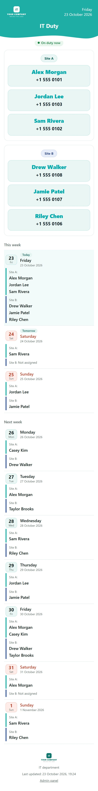
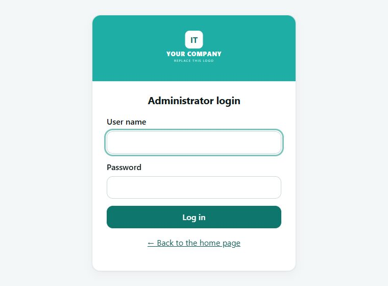
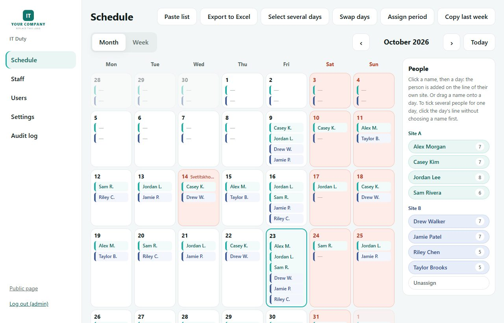
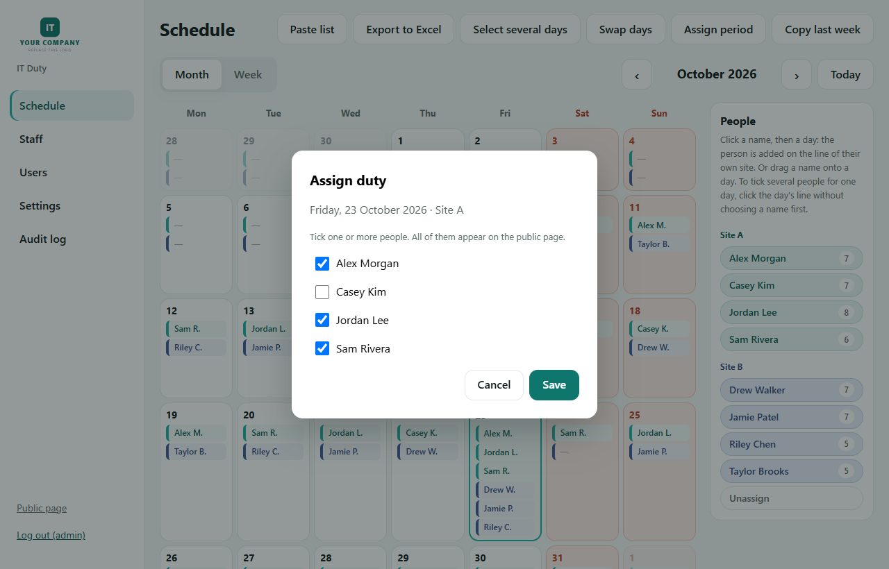
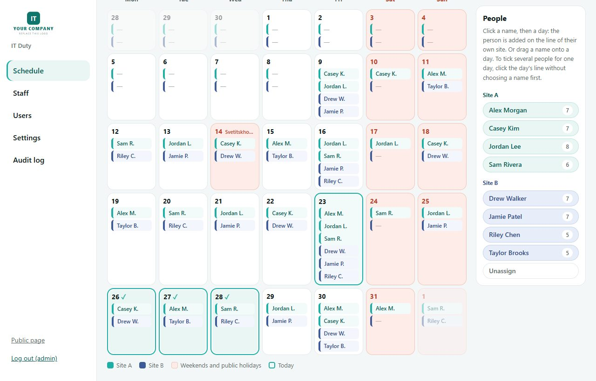
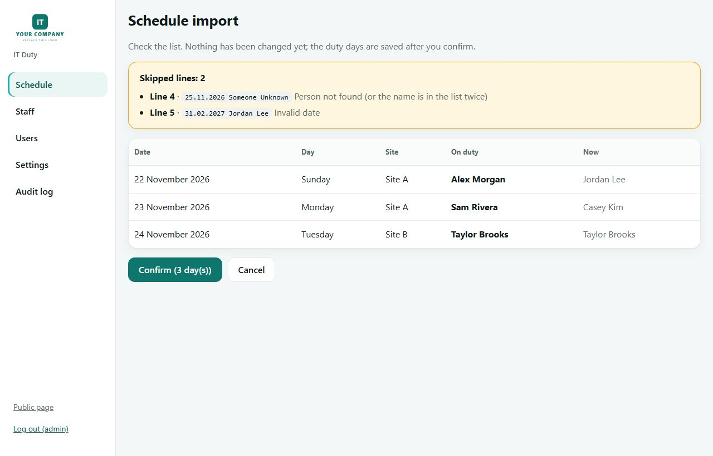
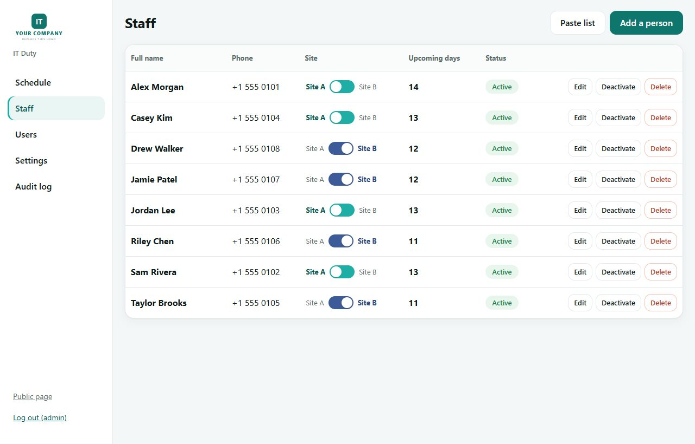
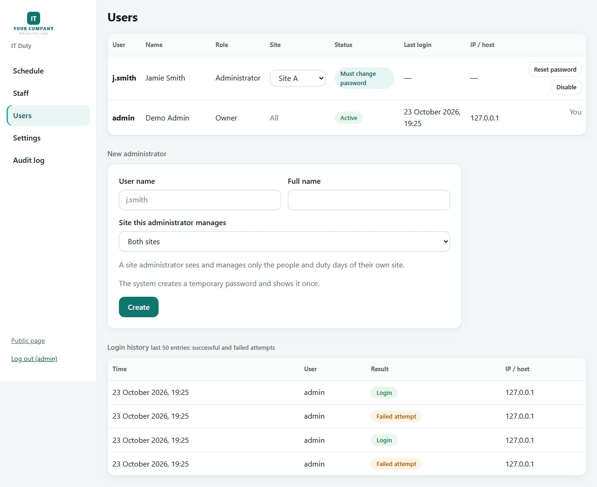
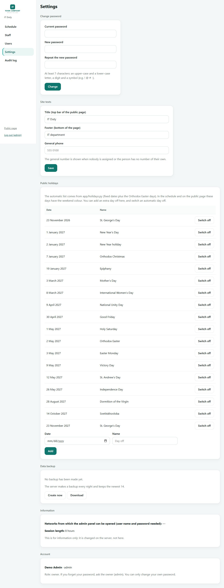
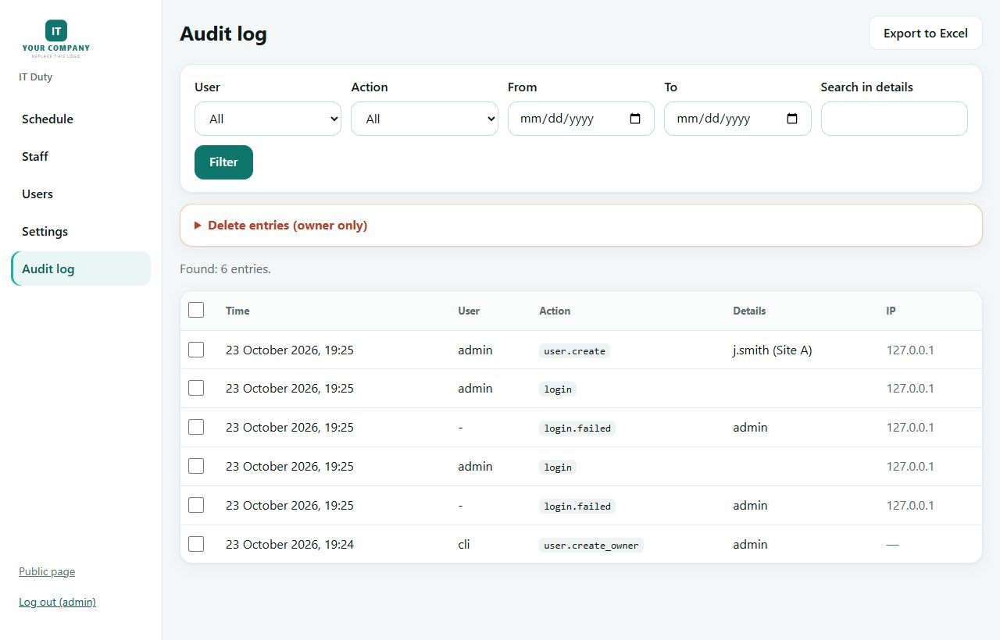

# it-duty-board

A small internal web site that shows **who is on IT duty today**. Two sites (**Site A** and **Site B**), each with one or more people on duty per day, a public page for colleagues and an admin panel for the IT team.

- **Public page** (`/`): everyone on duty today at each site (name and phone), plus this week and next week. Weekends and public holidays are highlighted. It refreshes itself every minute and works on a phone.
- **Admin panel** (`/admin`, user name and password): month and week calendar with a line per site and day, people palette, swap days, multi-day select and unassign, period assign, copy last week, paste import (from Excel), xlsx export, staff list with a Site A / Site B switch, users (each administrator can be limited to one site), settings, audit log, backups.
- **Internal only**: meant for company networks, never for the internet. The scripts in `vm/` build a locked-down host for it.
- **No e-mail anywhere**: only names and phone numbers are stored or shown.

Flask 3 + SQLite (WAL) + gunicorn, in one container with **no network at all**. nginx on the host talks to it over a unix socket. No CDN, no external fonts, no telemetry: it works fully offline.

> The logo in the screenshots is a placeholder. Replace `app/templates/_logo_teal.svg` and `app/templates/_logo_white.svg` with your own. The sample holiday list in `app/holidays.py` is Georgia's: edit it for your country.

## Screens

Screenshots use fictional demo data.

**Public page** (`/`): a card per site, each person on duty in their own box with the phone below the name, then this week and next week. Weekends and holidays are coral, today and tomorrow are tagged, and an empty slot says "Not assigned".



**Admin login** (`/admin`)



**Schedule**: the whole month on one screen with a line per site and day (Site A teal, Site B blue). Click a name in the palette, then a day, or drag a name onto a day: a person always lands on the line of their own site. Click a line with no name chosen to open a tick list for that day. Buttons: paste list (from Excel), Excel export, select several days, swap days, assign a period, copy last week.



**Several people on one day**: click a line and tick everyone who is on duty.



**Multi-day select**: pick several days, then assign one person to all of them or unassign them.



**Excel import preview**: the site comes from the person (Staff page). Nothing is saved until you confirm; unknown names and impossible dates are listed with the reason.



**Staff**: a switch per person (Site A on the left, Site B on the right), phone number, status, number of upcoming duty days, a warning when an inactive person still has future days, paste import and removal. When a person moves to the other site, their duty days from today on at the old site become "not assigned"; past days stay as history.



**Users** (owner only): role, site, status, last login time, IP address and host name, reset password, unlock, disable; create administrators (with the site they manage); history of successful and failed logins. A site administrator sees only the people of their site, can read but not change the other site's lines and can hand a person over to the other site but not take one from it.



**Settings**: own password; owner only: public holidays (automatic list plus extra days off), site title, footer and general contact, backups (create now, download) and a read-only info block.



**Audit log**: the owner sees every change, an administrator only their own entries. Filter by user, action, period and text; export to Excel. Only the owner can delete entries.



## Repository layout

| Path | What |
|------|------|
| `app/` | The Flask app: `main.py` (routes, CLI), `db.py` (schema, migrations), `xlsx_io.py` (Excel import/export), `holidays.py`, `templates/`, `static/` |
| `tests/smoke_test.py` | End-to-end smoke test (runs the whole app against a temporary database) |
| `Dockerfile`, `requirements.txt` | Container image |
| `vm/` | Scripts that build the host VM: `00-prep.sh` (OS, firewall, SSH, Docker), `09-cert.sh` (certificate), `10-deploy.sh` (nginx + container), `20-backup.sh`, `30-restore.sh`; settings in `duty.conf` (copy from `duty.conf.example`) |
| `docs/deployment.md` | Build, rebuild and restore the site on a VM, step by step |

## Run locally (development)

```bash
python -m venv .venv && . .venv/bin/activate        # Windows: .venv\Scripts\activate
pip install -r requirements.txt
export DATA_DIR=./data COOKIE_SECURE=0 FLASK_APP=app.main
flask bootstrap-admin          # first owner "admin" with a temporary password
flask seed-demo                # optional: sample people and days
flask run
python tests/smoke_test.py     # expect: ALL PASSED
```

Open http://127.0.0.1:5000 for the public page and http://127.0.0.1:5000/admin for the panel. Environment variables: `DATA_DIR` (database, secret key, backups), `TZ_NAME` (time zone, default `UTC`), `COOKIE_SECURE=0` (only for plain-http development).

## Deploy on a VM

Ubuntu 24.04. Short version: copy the repository to the VM, go to `vm/`, copy `duty.conf.example` to `duty.conf`, edit it, then as root, in order:

```bash
sudo bash 00-prep.sh              # time, packages, firewall (UFW), SSH, fail2ban, Docker
sudo bash 09-cert.sh selfsigned   # temporary certificate, 1 year
sudo bash 10-deploy.sh            # builds the image, writes the nginx config, starts, tests
sudo bash 20-backup.sh            # first backup + nightly job (03:00)
```

`10-deploy.sh` is safe to re-run; run it again after every code update. Full guide, including a certificate from your own CA, DNS, restoring a backup and final checks: [docs/deployment.md](docs/deployment.md).

## How access is limited

- Public page: only the networks listed in `WEB_NETS` (networks in `BLOCK_NETS`, e.g. guest Wi-Fi, are always refused). Everything else: the connection is dropped.
- `/admin`: the networks in `ITDUTY_ADMIN_NETS` (by default the same as `WEB_NETS`), and only a user name and password open the panel. Narrow the list to restrict it further.
- Login protection: five wrong passwords lock that user name **for that computer only** (15 minutes), so one person's typing or an attacker cannot lock the others out. The owner can unlock a computer or the whole account.
- Names: `ITDUTY_HOST` is the main name; old names in `REDIRECT_HOSTS` redirect (301, same path) to it.
- SSH: only from `ADMIN_SSH_NET`.
- Container: `network_mode: none`, read-only filesystem, all capabilities dropped, non-root, reachable only through the socket.
- Passwords: argon2id, minimum 7 characters with upper/lower/digit/symbol, lock after 5 wrong attempts, CSRF on every POST, strict CSP (no inline scripts, no CDN), session cookie HttpOnly + SameSite=Strict + Secure.
- Only the owner (`admin`) creates users, resets passwords, unlocks and disables accounts. Every change goes to the audit log.

## Data and operations

| Item | Where |
|------|-------|
| Database, secret key, backups | `<APP_DIR>/data/` on the VM (`itduty.db`, `secret.key`, `backups/`) |
| Certificate and key | `<APP_DIR>/certs/` (root only) |
| nginx config | generated by `10-deploy.sh` |

```bash
sudo docker exec it-duty flask list-users           # accounts, no secrets
sudo docker exec -it it-duty flask reset-password   # owner forgot the password: prints a temporary one
sudo docker exec it-duty flask backup               # backup now (keeps the newest 14)
sudo bash 30-restore.sh /path/to/backup.db          # restore (the current database is kept first)
```

## Troubleshooting

| Symptom | Check |
|---------|-------|
| Browser shows "not secure" | The certificate is still the self-signed one, or the PC does not trust the CA. Run `09-cert.sh install` with the CA certificate. |
| Empty response / cannot connect | Wrong DNS or an old `hosts` entry; the PC is outside `WEB_NETS`; `sudo ufw status`. |
| 502 from nginx | Container down or unhealthy: `sudo docker ps`, `sudo docker logs it-duty`; the socket `/run/duty/duty.sock` must exist. |
| A colleague cannot log in although the password is right | Probably locked after five wrong tries from that computer: Users page, locked computers, unlock (or wait 15 minutes). |
| Changes not visible on the public page | It reloads every 60 s; press Ctrl+F5 if a cached stylesheet is suspected. |

## License

MIT, see [LICENSE](LICENSE).
